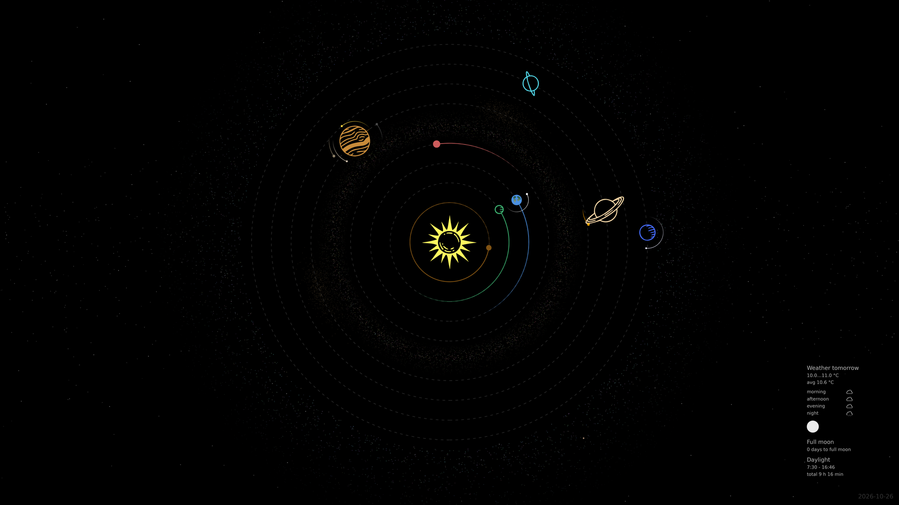

# Solarmap Wallpaper

A Python script that generates a visualization of our solar system as a desktop wallpaper.



## Features

- Real-time planetary positions using astronomical calculations
- Orbital trails showing recent planetary motion
- Major moons (Earth's Moon, Jupiter's Galilean moons, Saturn's Titan, etc.)
- Asteroid belt and Kuiper belt visualization
- Moon phase indicator
- Weather forecast (FMI API for Finland)
- Sunrise/sunset times
- Customizable resolution and colors

## Requirements

- Python 3.x
- See `requirements.txt` for dependencies

## Installation
```bash
git clone https://github.com/yourusername/solarmap.git
cd solarmap
python -m venv venv
source venv/bin/activate  # On Windows: venv\Scripts\activate
pip install -r requirements.txt
```

## Usage
```bash
python solarmap.py
```

The script generates `solarmap.png` in the current directory. By default, the wallpaper resolution is `1920x1080`, the generated map is in English, and the location is Helsinki Central Railway Station (`60.17101,24.94148`).

Use `--resolution WIDTHxHEIGHT` to choose an output resolution, `--language` to choose English (`en`) or Finnish (`fi`), and `--geolocation "LATITUDE, LONGITUDE"` to set the location for weather, moon phase, and sunrise/sunset data. Separate the coordinates with a comma and no spaces:

```bash
python solarmap.py --resolution 2560x1440 --language fi --geolocation 60.17101,24.94148
```

All arguments are optional. For example, `python solarmap.py --language fi` keeps the default resolution and location. If you include a space after the comma, quote the coordinate pair, e.g. `--geolocation "60.17101, 24.94148"`.

## Configuration

Edit the configuration section in `solarmap.py`:

- `custom_date` - Set a specific date or use "Now"
- `planet_colors` - Customize planet colors

## License

MIT License - see [LICENSE](LICENSE) file for details
